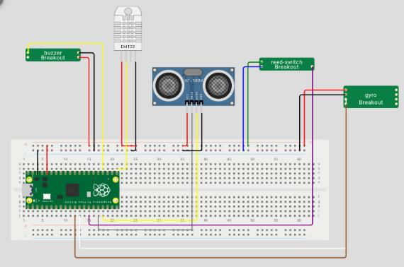
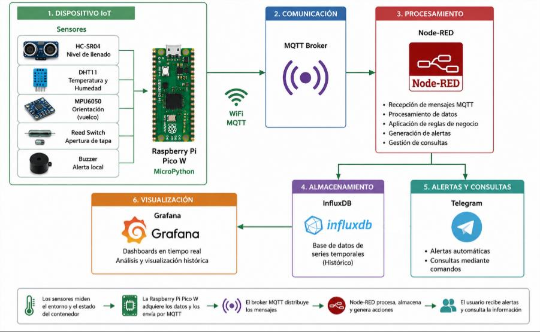
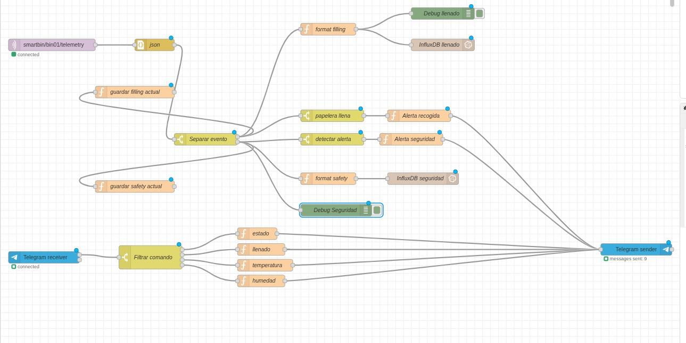
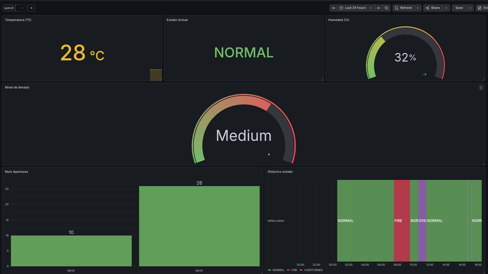
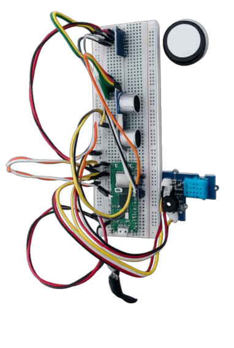
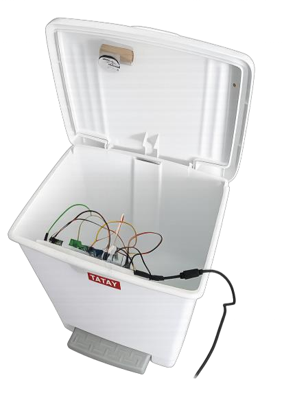

<p align="center">
  
</p>

[Spanish version](#versión-en-español)

# SmartBin

SmartBin is an IoT prototype for a smart waste bin that monitors fill level, lid activity, temperature, humidity, and orientation. The system publishes sensor data to MQTT and can be integrated with Node-RED, InfluxDB, and Grafana for visualization and alerting.

## Overview

The project uses a MicroPython-based controller running on a board with the following sensors:

- Ultrasonic sensor for measuring remaining bin height and estimating fill percentage
- Reed switch for detecting lid opening events
- DHT11 for temperature and humidity readings
- MPU6050 accelerometer and gyroscope for tilt/orientation detection
- Active buzzer for alerts

The firmware periodically measures safety conditions and publishes telemetry to an MQTT broker. A Node-RED flow then processes the incoming messages and stores them in InfluxDB, while Grafana visualizes the collected metrics.

## Features

- Fill level estimation based on ultrasonic distance
- Classification of bin level as Normal, Medium, Almost Full, or Urgent Collection
- Lid opening detection and open-count tracking
- Temperature and humidity monitoring
- Tilt detection and overturn risk detection
- Local buzzer alarm for abnormal conditions
- MQTT telemetry publishing
- Dashboard-ready data export for Node-RED and Grafana

## Architecture





## Dashboard



## Hardware




## Project files

- `smartBin.py` - main firmware for the smart bin device
- `smartBinNodeRed.json` - Node-RED flow configuration for MQTT ingestion and data routing
- `smartBinGrafana.json` - Grafana dashboard configuration for visualizing sensor data
- `wokwi/` - simulation files for Wokwi-based testing and hardware emulation

## Hardware used

Hardware used:

- Raspberry Pi Pico W
- HC-SR04
- DHT11 temperature and humidity sensor
- MPU6050 IMU module
- Reed switch connected to the lid
- Active buzzer

## Firmware behavior

The firmware in `smartBin.py` does the following:

1. Connects to Wi-Fi
2. Connects to the configured MQTT broker
3. Reads the reed switch to detect lid opening events
4. Measures distance when the lid opens, then calculates fill percent and fill level
5. Every 10 seconds, checks temperature and IMU-based orientation
6. Builds a status such as NORMAL, FIRE_ALERT, OVERTURNED, or FIRE_AND_OVERTURNED
7. Activates the buzzer for alert states
8. Publishes structured JSON telemetry to the MQTT topic `smartbin/bin01/telemetry`

## MQTT data model

The device sends JSON messages with fields similar to:

```json
{
  "bin_id": "bin01",
  "event": "lid_opening",
  "open_count": 2,
  "distance_cm": 12.35,
  "fill_percent": 54.2,
  "fill_level": "Level 2 - Medium",
  "timestamp": 1710000000
}
```

and safety messages like:

```json
{
  "bin_id": "bin01",
  "event": "safety_measurement",
  "temperature": 31.4,
  "humidity": 48.1,
  "orientation": "Face Up",
  "overturned": false,
  "status": "NORMAL",
  "timestamp": 1710000000
}
```

## Configuration

Before running the firmware, update these values in `smartBin.py`:

```python
WIFI_SSID = ""
WIFI_PASSWORD = ""
MQTT_BROKER = "test.mosquitto.org"
BIN_ID = "bin01"
```

You may also adjust thresholds used for fill level and alerting:

```python
BIN_HEIGHT_CM = 27
FIRE_TEMP = 35
THRESHOLD = 0.7
SAFETY_CHECK_INTERVAL = 10
```

## Setup steps

1. Flash MicroPython onto the board.
2. Upload `smartBin.py` to the device.
3. Set the Wi-Fi credentials and MQTT broker information.
4. Start an MQTT broker and connect the device.
5. Import `smartBinNodeRed.json` into Node-RED.
6. Configure InfluxDB and Grafana to work with the Node-RED outputs.
7. Import `smartBinGrafana.json` to display temperature, humidity, and fill metrics.

## Notes

- Wi-Fi credentials in smartBin.py and Telegram credentials are intentionally left empty and must be configured before deployment.
- Sensor thresholds and trigger logic may require calibration depending on the exact hardware and installation environment.

---

## Versión en español

SmartBin es un prototipo IoT para un contenedor inteligente que monitoriza el nivel de llenado, la actividad de la tapa, la temperatura, la humedad y la orientación. El sistema publica datos de sensores por MQTT y puede integrarse con Node-RED, InfluxDB y Grafana para visualización y alertas.

## Visión general

El proyecto utiliza un controlador basado en MicroPython que funciona en una placa con los siguientes sensores:

- Sensor ultrasónico para medir la altura restante del contenedor y estimar el porcentaje de llenado
- Reed switch para detectar aperturas de la tapa
- DHT11 para lecturas de temperatura y humedad
- MPU6050 para detectar inclinación y orientación
- Zumbador activo para alarmas

El firmware realiza mediciones periódicas de seguridad y publica telemetría a un broker MQTT. Un flujo de Node-RED procesa los mensajes y los almacena en InfluxDB, mientras Grafana visualiza las métricas recopiladas.

## Funcionalidades

- Estimación del nivel de llenado mediante distancia ultrasónica
- Clasificación del nivel del contenedor como Normal, Medio, Casi lleno o Recolección urgente
- Detección de apertura de la tapa y seguimiento del número de aperturas
- Monitorización de temperatura y humedad
- Detección de inclinación y riesgo de vuelco
- Alarma local con zumbador en condiciones anómalas
- Publicación de telemetría MQTT
- Exportación de datos lista para paneles con Node-RED y Grafana

## Arquitectura


## Dashboard


## Hardware


## Archivos del proyecto

- `smartBin.py` - firmware principal del dispositivo SmartBin
- `smartBinNodeRed.json` - configuración del flujo de Node-RED para ingestión y enrutamiento MQTT
- `smartBinGrafana.json` - configuración del panel de Grafana para visualizar los datos
- `wokwi/` - archivos de simulación para pruebas con Wokwi

## Hardware utilizado

Hardware utilizado:

- Raspberry Pi Pico W
- HC-SR04
- Sensor de temperatura y humedad DHT11
- Módulo IMU MPU6050
- Reed switch conectado a la tapa
- Zumbador activo

## Comportamiento del firmware

El firmware en `smartBin.py` hace lo siguiente:

1. Se conecta a Wi‑Fi
2. Se conecta al broker MQTT configurado
3. Lee el reed switch para detectar aperturas de la tapa
4. Mide la distancia cuando se abre la tapa y calcula el porcentaje de llenado y el nivel
5. Cada 10 segundos comprueba la temperatura y la orientación mediante IMU
6. Genera un estado como NORMAL, FIRE_ALERT, OVERTURNED o FIRE_AND_OVERTURNED
7. Activa el zumbador en estados de alerta
8. Publica telemetría JSON estructurada en el topic MQTT `smartbin/bin01/telemetry`

## Modelo de datos MQTT

El dispositivo envía mensajes JSON con campos similares a:

```json
{
  "bin_id": "bin01",
  "event": "lid_opening",
  "open_count": 2,
  "distance_cm": 12.35,
  "fill_percent": 54.2,
  "fill_level": "Level 2 - Medium",
  "timestamp": 1710000000
}
```

y mensajes de seguridad como:

```json
{
  "bin_id": "bin01",
  "event": "safety_measurement",
  "temperature": 31.4,
  "humidity": 48.1,
  "orientation": "Face Up",
  "overturned": false,
  "status": "NORMAL",
  "timestamp": 1710000000
}
```

## Configuración

Antes de ejecutar el firmware, actualiza estos valores en `smartBin.py`:

```python
WIFI_SSID = ""
WIFI_PASSWORD = ""
MQTT_BROKER = "test.mosquitto.org"
BIN_ID = "bin01"
```

También puedes ajustar los umbrales utilizados para el nivel de llenado y las alertas:

```python
BIN_HEIGHT_CM = 27
FIRE_TEMP = 35
THRESHOLD = 0.7
SAFETY_CHECK_INTERVAL = 10
```

## Pasos de configuración

1. Flashea MicroPython en la placa.
2. Sube `smartBin.py` al dispositivo.
3. Configura las credenciales Wi‑Fi y la información del broker MQTT.
4. Inicia un broker MQTT y conecta el dispositivo.
5. Importa `smartBinNodeRed.json` en Node-RED.
6. Configura InfluxDB y Grafana para que funcionen con la salida de Node-RED.
7. Importa `smartBinGrafana.json` para visualizar métricas de temperatura, humedad y llenado.

## Notas

- Las credenciales Wi‑Fi en `smartBin.py` y las credenciales de Telegram se dejan intencionalmente vacías y deben configurarse antes del despliegue.
- Los umbrales de los sensores y la lógica de activación pueden requerir calibración según el hardware exacto y el entorno de instalación.

---
